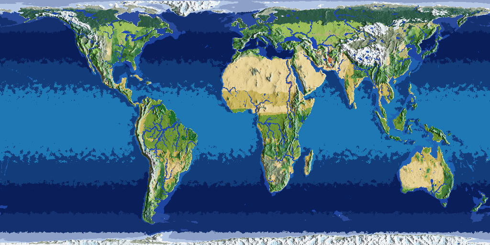
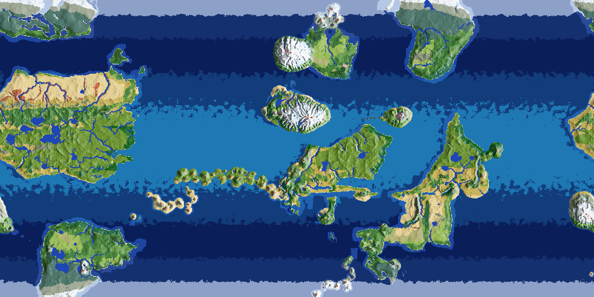
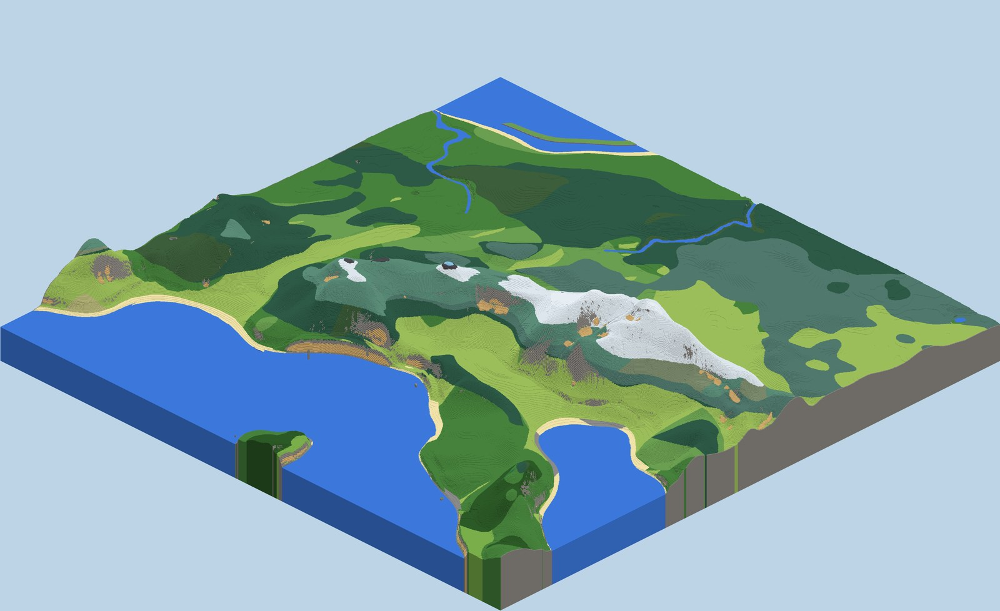
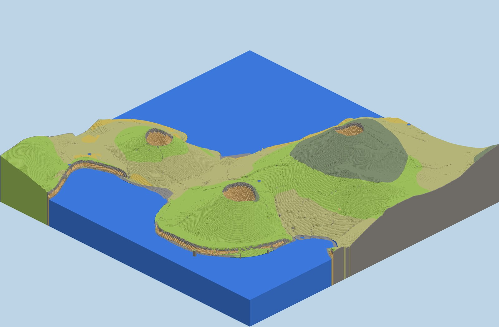
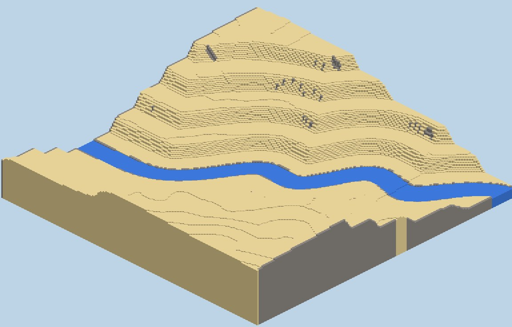

# Realistic Tectonics

A Minecraft world generator for **NeoForge 1.21.1** that doesn't use noise to fake terrain: it simulates a whole planet
first, then builds the blocks from it.

Plates drift, collide and rift; mountains rise where they meet and wear down under rain and ice; rivers find their way to
the sea and carve their valleys; winds, ocean currents and monsoons decide where it rains, and the climate decides the
biomes. Every mountain range, desert and river in the world is there for a reason.


*The "Tectonic Earth" world type: Earth's real continents and plates, with the simulated rivers, climate and biomes.*


*A random planet (seed 777): continents from a simulated supercontinent cycle, deserts in the subtropics, ice on the high ground.*

## What is simulated

- **Plate tectonics**: plates, collisions, subduction, rifts, strike-slip faults, mid-ocean ridges and trenches,
  hotspots and volcanic island chains, and the supercontinent cycle.
- **Erosion and rivers**: stream-power erosion, river networks with deltas and lakes, glaciers that carve valleys and
  flow as ice with moraines, calderas that collapse into crater lakes, and gullies, rockfall and scree at block scale.
- **Climate**: temperature with height and latitude, ocean currents, rain shadows, monsoons, the subtropical desert
  belt, moisture recycling over land, lake-effect rain, mountain ranges that block and deflect the winds, and the warmth
  of high plateaus. It is checked against the real Köppen climate map on the Earth planet (75% agreement on the main
  climate groups).
- **Biomes** follow from that climate, with seasons: rainforest, savanna, desert, steppe, Mediterranean scrub, taiga,
  tundra and the rest, plus green strips along rivers through deserts, salt flats, beaches, marshes and mountain zones.
  With Biomes O' Plenty installed, it uses BOP's biomes too, several per climate.

| | |
|---|---|
|  |  |
| *A mountain range with snow, glaciers and scree, rendered from the game's own terrain code.* | *Volcanoes with craters, set on the coast where the plates put them.* |
|  | |
| *A river through a desert, cutting into folded rock layers.* | |

## Installing

1. Install [NeoForge](https://neoforged.net/) for Minecraft 1.21.1 (Java 21).
2. Put the mod's jar in your `mods` folder.
3. When you create a world, open **More World Options → World Type** and pick **Tectonic Planet** or **Tectonic Earth**.
   The *Customize* button opens the planet settings.

The planet is simulated once when the world is created and saved as `planet.bin` in the world folder. Press **M** in game
to see the whole planet (**G** switches to its rocks); right-click a spot on the map to teleport there.

### Recommended settings

| Setting | What it does | Suggested |
|---|---|---|
| Size | Cells around the planet: Small, Medium, Large, Huge | Medium to start; Huge for the most realistic world |
| World scale | Blocks per cell: x1, x2, x4 | x2 on Huge (heights about 10x real); x4 for the most realistic proportions |
| Mountains | How tall the land stands | 1.0 |
| Plates | Number of tectonic plates | 14-16 |
| Ocean | Share of the surface under water | 0.70 (Earth is 71%) |
| Steps | How long the plates move: young planets have many small continents, old ones a few big worn ones | 300-400 |
| Volcanoes | How many | 1.0 |
| Rivers | River width | 2-2.5 |

Large and Huge planets need more memory to create (Huge: give Minecraft 4-6 GB).

**Smooth play:** add `-XX:+UseZGC -XX:ConcGCThreads=3` to Minecraft's Java arguments (in your launcher's installation settings). Chunks
generate all the time while you play (more so with Distant Horizons), and Java's default garbage collector then pauses
the game for up to ~35 ms at a time: microstutters. ZGC keeps its pauses under a millisecond.

### Works well with

- **[Distant Horizons](https://modrinth.com/mod/distanthorizons)**: see whole mountain ranges on the horizon.
- **[Biomes O' Plenty](https://modrinth.com/mod/biomes-o-plenty)**: picked up automatically for new worlds.
- **[C2ME](https://modrinth.com/mod/c2me-neoforge)**: about twice the chunk generation speed on a server.

## Building

```
./gradlew build          # the jar ends up in build/libs
./gradlew runClient      # a dev client with Distant Horizons and Biomes O' Plenty
./gradlew test
```

The simulation in `src/main/java/com/realtectonics/sim` has no Minecraft classes, so it runs on its own in tests and
jshell. `tools/` holds the scripts used to render and check the terrain and to compare the climate with the real world
(see `tools/README.md`), and `docs/FORMATS.md` lists every change to how terrain looks; old worlds keep the look they
were made with.

## License

All rights reserved.
